# TerroTrack

An [Obsidian](https://obsidian.md) plugin for tracking **Movies, TV Shows & Anime**. Discover what to watch next, build collections, and keep everything in your own vault. Your data is stored as plain JSON and can be exported as CSV.

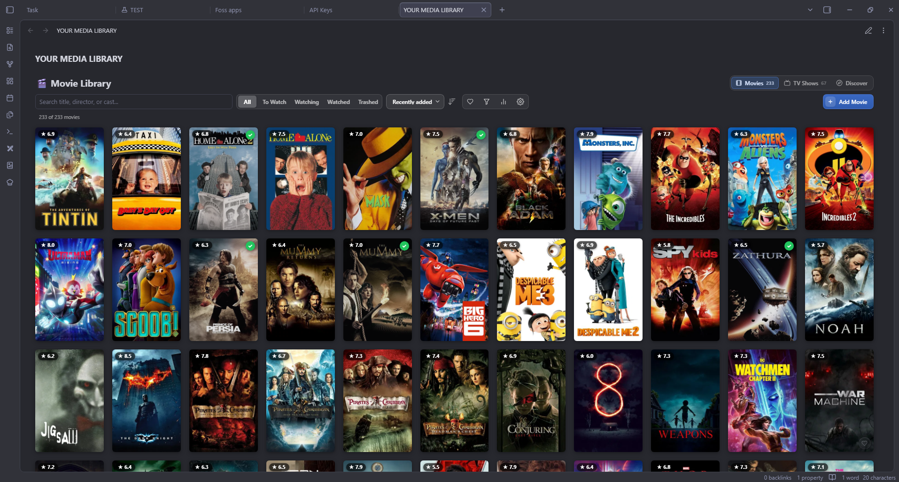
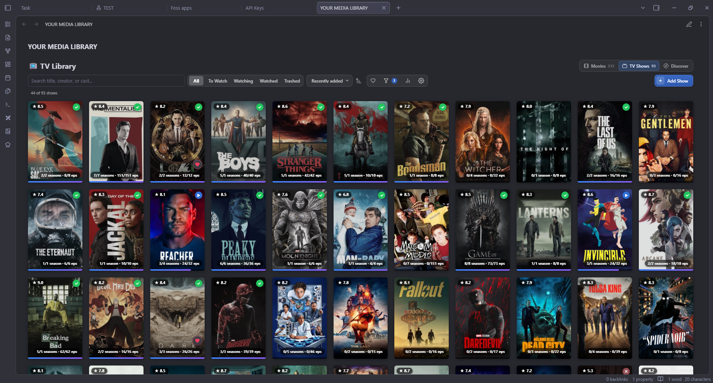

---

## Quick Navigation

<p align="center">
  <a href="#-features"><strong>✨ Features</strong></a> ·
  <a href="#-usage"><strong>📖 Usage</strong></a> ·
  <a href="#-anime"><strong>🎌 Anime</strong></a> ·
  <a href="#-screenshots"><strong>📸 Screenshots</strong></a> ·
  <a href="#-installation"><strong>📦 Installation</strong></a> ·
  <a href="#quick-start"><strong>🚀 Quick Start</strong></a> ·
  <a href="#-data-storage"><strong>💾 Data Storage</strong></a> ·
  <a href="#-backup--import"><strong>💾 Backup & Import</strong></a> ·
  <a href="#-updating"><strong>🔄 Updating</strong></a> ·
  <a href="#-compatibility"><strong>📱 Compatibility</strong></a> ·
  <a href="#-credits"><strong>🙏 Credits</strong></a> ·
  <a href="#-license"><strong>📄 License</strong></a>
</p>

---

## ✨ Features

**Libraries**
- 🎬 Movie & 📺 TV show libraries, each with its own card fields, filters, and stats
- 🖼️ Poster-based gallery with adjustable card size and column count
- 🎛️ Four-way status: **To Watch · Watching · Watched · Trashed**
- ❤️ Favourites — one-tap heart on posters, plus a favourites-only toolbar filter
- ⭐ Personal star ratings, 5 stars at half-star precision
- 📝 Personal notes with a preview card and a full reading/editing layer
- 📄 **MD** button — open or create a real Markdown note for any title, with its details as properties
- 📚 **Collections** — group movies, shows and anime into your own lists
- ☑️ Multi-select — set status, favourite, update, add to a collection, or delete many titles at once
- 🎲 **Pick for me** — a random title from your To Watch list, filtered by genre and length

**Progress**
- 📺 TV and anime progress tracks seasons and episodes together
- ⏳ Time left — remaining episodes × episode length, shown beside the progress bar
- 📅 Per-day logging date, so you can log past viewing on the day it happened
- 🔔 **This week** bell — new episodes and releases for the titles in your library (anime uses its AniList airing schedule)

**Discover**
- ✨ Picked for you — recommendations built from your own ratings, genres, and watch history
- 🔥 Trending this week
- 📅 Upcoming (movies) / Coming soon (TV and anime) · 📡 On the air (TV) / Airing now (anime)
- Movies and TV Discover need a TMDB API key. **Anime Discover uses AniList and needs no key.**

**Search, filter, sort**
- 🔍 Search by title, director/creator, and cast (anime: studio and voice actor)
- 🏷️ Filter by genre, year, language, TMDB rating, and your own rating (+ series status on TV, **format** on anime: TV, Movie, ONA, OVA, Special)
- 📆 Dual-handle year picker with Range and Individual modes
- ↕️ Sort by Recently added, Title, Year, Rating, My rating, or Runtime, ascending or descending

**Stats**
- 🔀 One window with a **Movies / TV / Anime** switch that changes every section
- ⏱️ Total watch time with a playful tier badge
- 📊 Watched / Watching / To Watch / Trashed breakdown with percentages
- 🎯 Genre breakdown and viewing habits — favourite year, top director/creator/studio, most-seen actor — click to jump to those titles
- 🗓️ GitHub-style activity heatmap with Week / Month / Year / All-time views and current/longest streak tiles. All-time shows years across and months down, so any number of years stays one compact table

**Data**
- 📄 Plain JSON storage — inspect, edit, or move it outside Obsidian
- 💾 CSV backups (full round-trip) and TXT exports
- 📥 Import from TerroTrack backups, IMDb, Letterboxd (movies only), MyAnimeList and AniList
- 📤 Export anime to a MyAnimeList XML file
- 🔄 Update database — re-fetch metadata while keeping your status, notes, ratings, and progress

---

## 📖 Usage

### Managing Your Library

**Add a title → Rate it → Track seasons & episodes → Add personal notes → Edit details → Update information → Watch trailer**

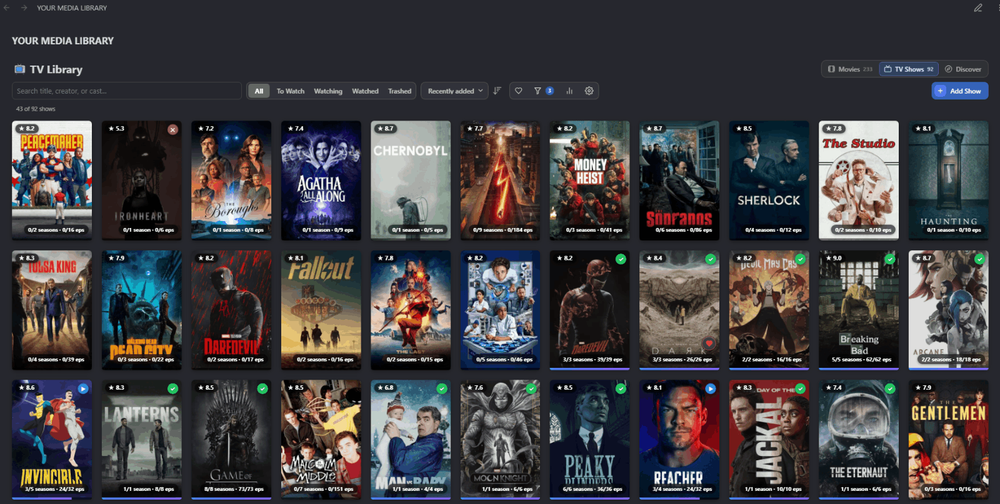

### Searching Your Library

Search your collection by title, director (creator, for TV), and cast. Anime also searches studio and voice actor.
> Title is always searched. Director and Cast can be toggled in **Gallery Settings** (both are on by default).

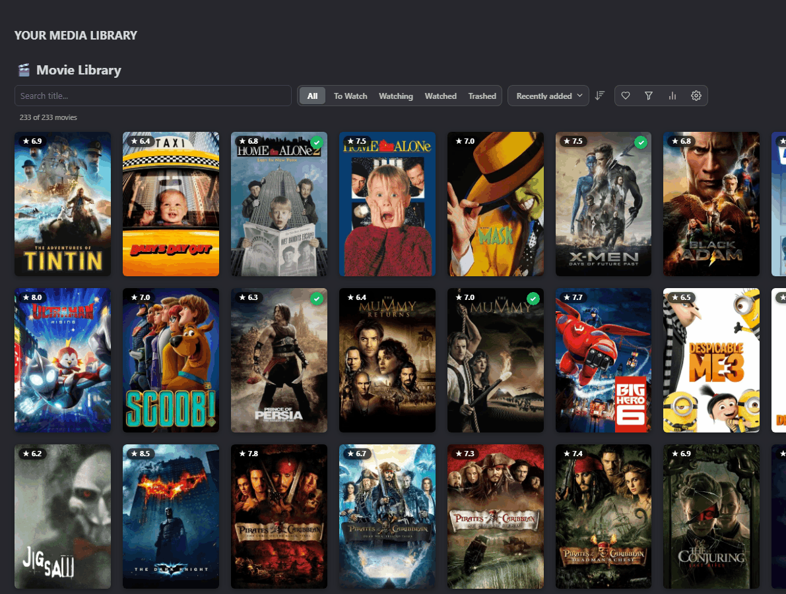

### Collections

Open the **Collections** tab and create a list. Add titles from a title's details (the **Collection** button), or select several posters and use **Collection** in the selection bar. A collection can mix movies, TV shows and anime.

### Showing part of your library in a note

A block with no options is the full library. Add options and it becomes a filtered list you can place anywhere in your notes:

````
```terro-movie
type: movies
status: watched
genre: Drama
sort: rating
limit: 10
title: My top dramas
```
````

| Option | Values |
| ------ | ------ |
| `type` | `movies` (default for `terro-movie`), `tv` (default for `terro-tv`), or `all` |
| `status` | `to watch`, `watching`, `watched`, `trashed` |
| `favorite` | `true` |
| `genre` | one or more genres, comma-separated |
| `year` | `2010`, a list `1999, 2004`, or a range `2010-2020` |
| `language` | language code, e.g. `en` |
| `collection` | the name of one of your collections |
| `person` | a director, creator, or actor |
| `min_rating`, `min_my_rating` | minimum TMDB rating / your own rating |
| `search` | text to find in the title |
| `sort` | `added` (default), `title`, `year`, `rating`, `myrating`, `runtime` |
| `dir` | `asc` or `desc` |
| `limit` | maximum number of titles |
| `title` | heading shown above the list |

> Filtered blocks list movies and TV shows. Anime lives in the full library (the **Anime** tab).

---

## 📸 Screenshots

<details>
<summary><strong>Similar Titles</strong></summary>
<br>

<p align="center">
  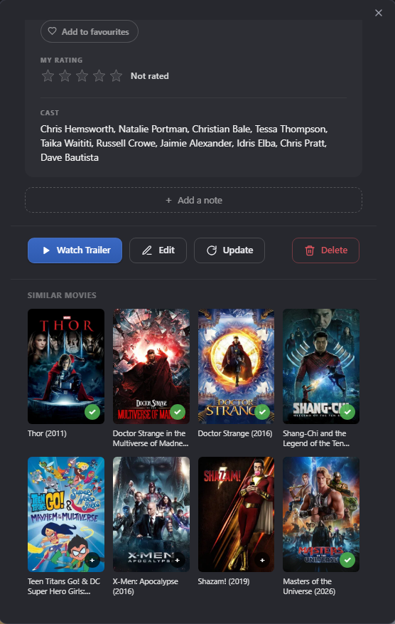
</p>

</details>

<details>
<summary><strong>⚙️ Gallery settings</strong></summary>
<br>

<p align="center">
  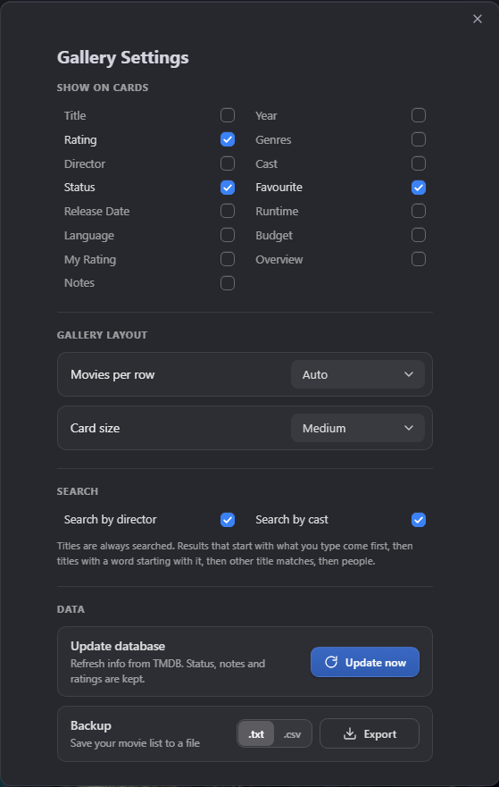
  
</p>

</details>

<details>
<summary><strong>🎛️ Filters</strong></summary>
<br>

<p align="center">
  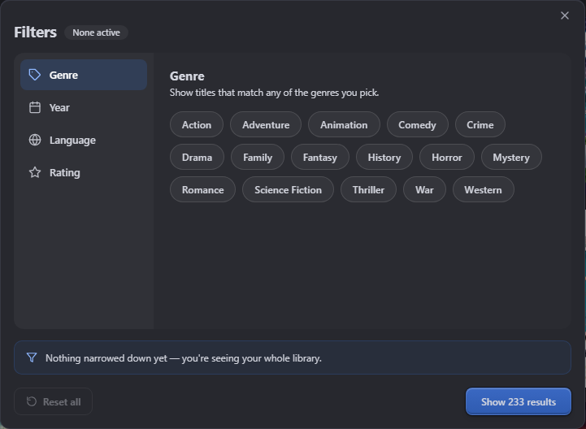
  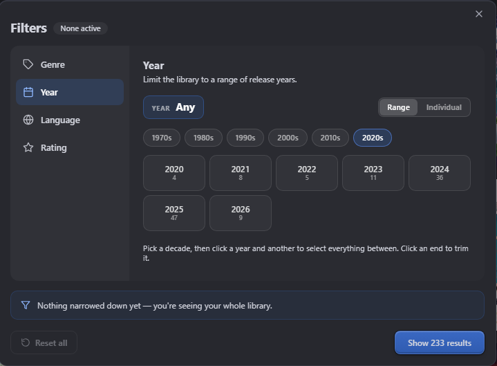
  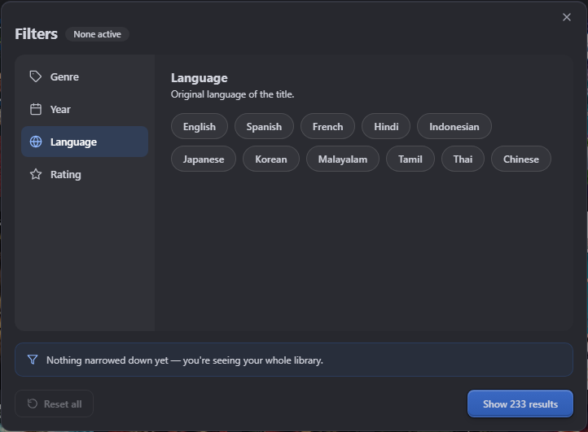
  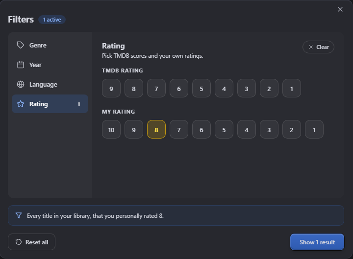    
</p>

</details>

<details>
<summary><strong>📊 Library Stats</strong></summary>
<br>

<p align="center">
  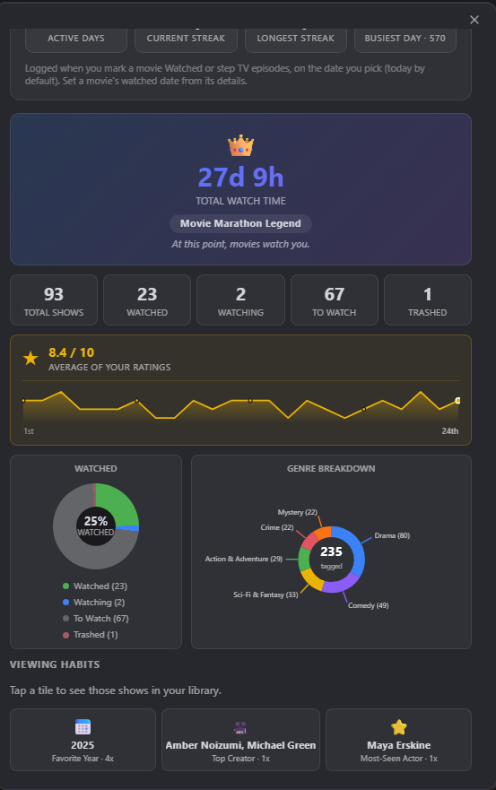
  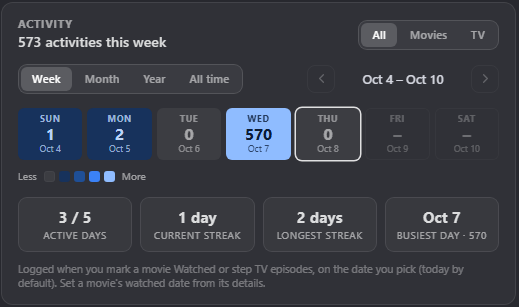
  <br>
  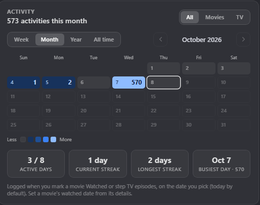
  <br>    
  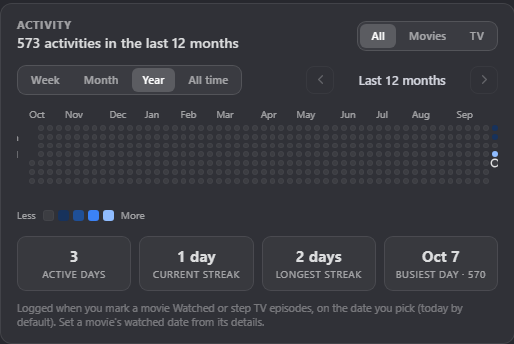
</p>


</details>

---

## 📦 Installation

### Manual Installation

> Make sure to turn off restricted mode.
#### 1. Download
- Download **TerroTrack** from the [latest release](https://github.com/cyber-joy/TerroTrack/releases).
- Extract the ZIP file.
#### 2. location
- Open your Obsidian vault's plugin folder.
- Copy the entire plugin folder into it.
      
```
YourVault/
└── .obsidian/
    └── plugins/
```

#### 3. Enable the Plugin
- Open Obsidian **Settings** → **Community plugins**
- Find **TerroTrack** in the installed plugins list.
- Enable it.

<p>
    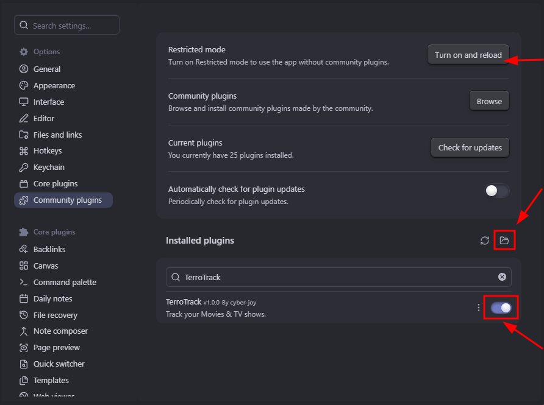
</p>

---

## Quick start

### 1. Add your TMDB API key

- Go to **Settings → TerroTrack → TMDB API key**.
- Paste your key.

Don't have one? See [How to get your free TMDB API key](#How-to-get-your-free-TMDB-API-key). Anime does not need it.

### 2. Open your Library

In any note, add either:

````
```terro-movie

```
````
or
````
```terro-tv

```
````

Both render the same interface with **Movies · TV Shows · Anime · Collections · Discover** tabs. The only difference is which tab opens first.

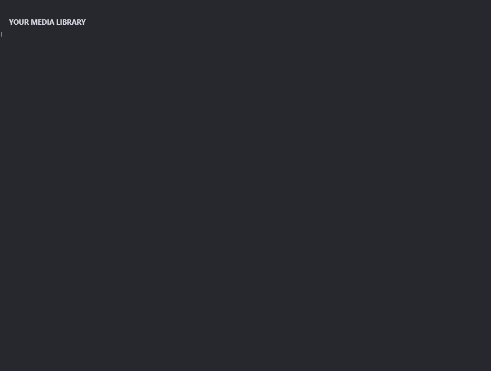

You can also add titles from the command palette with **Add movie** and **Add TV show**.

### 3. Add your first title

Click `+ Add Movie`, `+ Add Show`, or add an anime.

Search and select a result, or use **OR ENTER MANUALLY** for titles that aren't available online.

---

## 💾 Data storage

By default, TerroTrack writes three files to your vault root:

| File                | Contents                                 |
| ------------------- | ---------------------------------------- |
| `movies.json`       | Your movie library                       |
| `tvshows.json`      | Your TV library                          |
| `anime.json`        | Your anime library                       |
| `collections.json`  | Your collections                         |
| `activity.json`     | Daily activity counts behind the heatmap |

Markdown notes created with the **MD** button go in a **TerroTrack Notes** folder (change it in **Settings → TerroTrack → MD notes folder**). Plugin settings are kept in the plugin's own `data.json`.

All file paths can be changed in **Settings → TerroTrack**.

Everything is plain JSON — you can open, edit, or move it outside Obsidian.

<details>
<summary><strong>Movie entry example</strong></summary>

```json
{
  "id": 438631,
  "title": "Dune",
  "year": "2021",
  "poster_path": "/d5NXSklXo0qyIYkgV94XAgMIckC.jpg",
  "rating": "8.2",
  "myRating": "9",
  "watched": true,
  "watchedDate": "2026-02-14",
  "favorite": true,
  "release_date": "2021-10-22",
  "runtime": 155,
  "original_language": "en",
  "budget": 165000000,
  "genres": "Science Fiction, Adventure",
  "director": "Denis Villeneuve",
  "cast": "Timothée Chalamet, Rebecca Ferguson, ...",
  "overview": "...",
  "notes": "",
  "trailer_key": "8g18jFHCLXk"
}
```

</details>

<details>
<summary><strong>TV entry example</strong></summary>

```json
{
  "id": 1396,
  "name": "Breaking Bad",
  "year": "2008",
  "poster_path": "/ggFHVNu6YYI5L9pCfOacjizRGt.jpg",
  "rating": "8.9",
  "myRating": "10",
  "watched": true,
  "first_air_date": "2008-01-20",
  "last_air_date": "2013-09-29",
  "show_status": "Ended",
  "episode_runtime": 47,
  "original_language": "en",
  "genres": "Drama, Crime",
  "creators": "Vince Gilligan",
  "cast": "Bryan Cranston, Aaron Paul, ...",
  "overview": "...",
  "notes": "",
  "trailer_key": "",
  "number_of_seasons": 5,
  "number_of_episodes": 62,
  "season_episodes": [7, 13, 13, 13, 16],
  "seasonsWatched": 2,
  "episodesWatched": 20
}
```

</details>

<details>
<summary><strong>Anime entry example</strong></summary>

```json
{
  "id": 5114,
  "anilist_id": 5114,
  "mal_id": 5114,
  "name": "Fullmetal Alchemist: Brotherhood",
  "title_english": "Fullmetal Alchemist: Brotherhood",
  "title_romaji": "Hagane no Renkinjutsushi: FULLMETAL ALCHEMIST",
  "year": "2009",
  "rating": "9.1",
  "rating_source": "AniList",
  "myRating": "10",
  "status": "watching",
  "format": "TV",
  "show_status": "Ended",
  "episode_runtime": 24,
  "genres": "Action, Adventure, Drama, Fantasy",
  "creators": "Bones",
  "overview": "...",
  "notes": "",
  "number_of_seasons": 1,
  "number_of_episodes": 64,
  "episodesWatched": 20
}
```

For a title that is still airing, `total_known` is `false` and `episodes_aired` holds the number of episodes out so far.

</details>

---

## 💾 Backup & Import

TerroTrack supports library backup and import through **Gallery Settings → Data**.

- **CSV** — Full library backup that can be re-imported.
- **TXT** — Simple numbered list of your library.
- **TerroTrack** — Import previous CSV backups.
- **IMDb** — Import movie and TV exports.
- **Letterboxd** — Import movie exports, including ratings and watchlists.
- **MyAnimeList** — Import an XML export into your anime library, or export your library back to XML.
- **AniList** — Import a public AniList list by username.

---

## 🔄 Updating

Download the latest release and replace the existing `TerroTrack` plugin folder with the new version.

Your library data will remain intact.

To refresh a title's information, open it and press **Update**, or select several titles and use **Update** in the selection bar. **Update database** in Gallery Settings refreshes the whole library. Your status, notes, ratings, and progress are kept.

---

## How to get your free TMDB API key
1. Create a free account at [themoviedb.org](https://www.themoviedb.org).
2. Go to **Settings → [API](https://www.themoviedb.org/settings/api)**.
3. Request an API key and choose the **Developer** option.
4. Copy the **API Key (v3 auth)** — a 32-character hex string.
5. Paste it into **Settings → TerroTrack → TMDB API key**.

The key is stored in the plugin's `data.json` and stays on your machine.

Without it, the plugin still works — manual entry, gallery, filters, sorting, notes, ratings, backups, native-backup imports, and the whole anime side (AniList and MyAnimeList search, Discover, updates) all function. You lose TMDB search for movies and TV, their Discover rows, metadata updates, and IMDb/Letterboxd enrichment.

---

## 📱 Compatibility

* **Desktop:** Windows · macOS · Linux
* **Mobile:** Android · iOS

---

## 🙏 Credits

TerroTrack is an independent project. It is not affiliated with, or endorsed by, any of the services below.


**This product uses the TMDB API but is not endorsed or certified by TMDB.**

- 🎬 Movie and TV information and images come from [TMDB](https://www.themoviedb.org) (The Movie Database).
- 🎌 Anime information, images and airing schedules come from [AniList](https://anilist.co) and [MyAnimeList](https://myanimelist.net). [Jikan](https://jikan.moe), an unofficial MyAnimeList API, is used only as a fallback.
- 🖼️ Posters and artwork belong to their respective rights holders. They are loaded from these services when shown and are not stored in your vault.
- ✏️ Many of the small icons are based on [Lucide](https://lucide.dev) (ISC licence) and [Feather](https://feathericons.com) (MIT licence).

---

## 📄 License

MIT — see [LICENSE](LICENSE).
